# 使用 Anthropic MCP 进行网页爬虫

[](https://www.bright.cn/)

本指南介绍如何设置 MCP 服务器以按需提取数据、连接开发工具，以及如何利用 Bright Data 即时获取与 AI 兼容的网络信息。

- [了解局限性：为什么 LLM 需要帮助才能与现实世界交互](#了解局限性为什么-llm-需要帮助才能与现实世界交互)
- [MCP 的重要性](#mcp-的重要性)
- [了解模型上下文协议](#了解模型上下文协议)
- [MCP 架构详解](#mcp-架构详解)
- [开发你自己的 MCP 服务器](#开发你自己的-mcp-服务器)
- [连接你的 MCP 服务器](#连接你的-mcp-服务器)
- [使用 Bright Data 的 MCP 进行专业网页数据提取](#使用-bright-data-的-mcp-进行专业网页数据提取)
- [延伸阅读](#延伸阅读)

## 了解局限性：为什么 LLM 需要帮助才能与现实世界交互

大语言模型（LLM）擅长处理和生成来自海量训练数据集的文本。然而，它们面临一个关键限制：无法自然地与外部世界交互。这意味着它们没有访问本地文件、执行自定义脚本或从网站检索最新信息的内置能力。

来看一个简单示例：如果没有其他工具，就无法让 Claude 从当前有效的亚马逊商品页面中提取详细信息。为什么？因为它本身不具备浏览互联网或触发外部操作的能力。

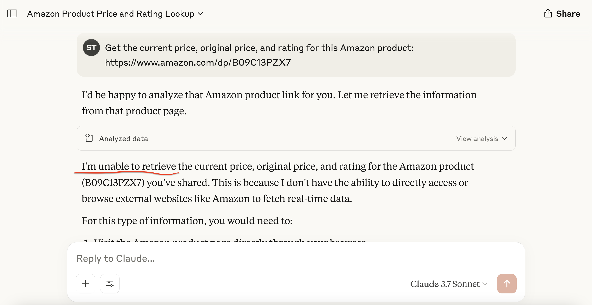

如果没有辅助工具，LLM 就无法执行依赖实时数据或外部系统集成的实际任务。

这正是 [Anthropic 的模型上下文协议（MCP）](https://www.anthropic.com/news/model-context-protocol)的价值所在。它让 LLM 能够以安全、标准化的方式与数据提取工具、API 或脚本等外部工具通信。

下面展示了实际效果。集成自定义 MCP 服务器后，我们成功地通过 Claude 直接提取了结构化的亚马逊商品信息：

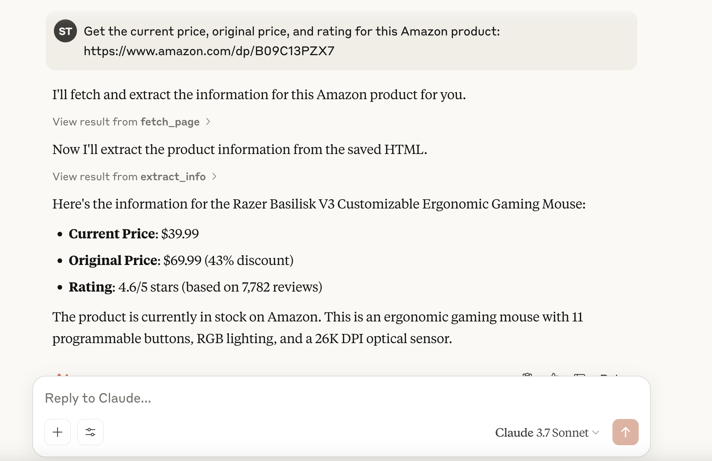

## MCP 的重要性

- **标准化：** MCP 为基于 LLM 的系统提供统一接口，用于连接外部工具和数据，类似于 API 对网络集成的标准化。这显著减少了自定义集成的需求，从而加快开发速度。
- **灵活性和可扩展性：** 开发者无需重写工具集成，即可更换 LLM 或托管平台。MCP 支持多种通信方式（例如 `stdio`），能够适应各种配置。
- **增强 LLM 能力：** 通过将 LLM 连接到最新数据和外部工具，MCP 让它们能够突破静态响应的限制。现在，它们可以提供最新且相关的信息，并根据上下文触发现实世界中的操作。

> **类比**：
> 
> 你可以将 MCP 视为 LLM 的 USB 接口。正如 USB 让不同设备（键盘、打印机、外置硬盘）无需专用驱动程序即可连接任何兼容的机器，MCP 也让 LLM 能通过标准化协议连接各种工具，而不必每次都进行自定义集成。

## 了解模型上下文协议

模型上下文协议（MCP）是 Anthropic 开发的一项开放标准，让大语言模型（LLM）能够以一致且安全的方式与外部工具、API 和数据源交互。它就像一个通用连接器，让 LLM 能够执行提取网站数据、查询数据库或运行脚本等现实任务。

虽然 MCP 由 Anthropic 推出，但它是开放且可扩展的，这意味着任何人都可以实现该标准或为其做出贡献。如果你使用过[检索增强生成（RAG）](https://www.bright.cn/blog/web-data/rag-explained)，应该能理解这个概念。MCP 在这一理念的基础上，通过轻量级 JSON-RPC 接口实现交互标准化，使模型可以访问实时数据并执行操作。

## MCP 架构详解

从根本上说，MCP 对 AI 模型与外部能力之间的通信进行了标准化。

**核心理念：** 标准化接口（通常是通过 `stdio` 等传输方式使用 JSON-RPC 2.0）让 LLM 能够通过客户端发现并调用外部服务器公开的工具。

MCP 采用客户端-服务器架构，包含三个关键组件：

1. **MCP 主机**：发起并管理 LLM 与外部工具之间交互的环境或应用程序。例如 _Claude Desktop_ 等 AI 助手，或 _Cursor_ 等 IDE。
2. **MCP 客户端**：主机内用于建立并维护与 MCP 服务器连接的组件，负责处理通信协议和管理数据交换。
3. **MCP 服务器：** 实现 MCP 协议并公开一组特定功能的程序（由我们开发者创建）。MCP 服务器可以连接数据库、网络服务，或在本例中连接网站（亚马逊）。服务器通过标准化方式公开其功能：
   - **工具：** 可调用的函数（例如 _scrape\_amazon\_product_、_get\_weather\_data_）
   - **资源：** 用于检索静态数据的只读端点（例如获取文件、返回 JSON 记录）
   - **提示词：** 用于指导 LLM 与工具和资源交互的预定义模板

以下是 MCP 架构图：

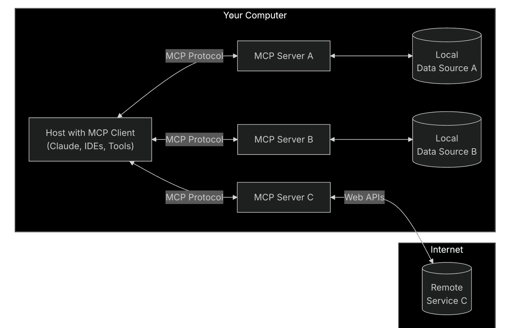

_图片来源：[模型上下文协议](https://modelcontextprotocol.io/introduction)_

在此设置中，**主机**（Claude Desktop 或 Cursor IDE）会生成一个 **MCP 客户端**，后者再连接外部 **MCP 服务器**。该服务器会公开工具、资源和提示词，让 AI 可以根据需要与其交互。

简而言之，工作流程如下：

- 用户发送一条消息，例如 _“从这个亚马逊链接中获取商品信息。”_
- MCP 客户端检查是否有已注册的工具能够处理该任务
- 客户端向 MCP 服务器发送结构化请求
- MCP 服务器执行相应操作（例如启动无头浏览器）
- 服务器将结构化结果返回给 MCP 客户端
- 客户端将结果转发给 LLM，后者再向用户展示这些结果

## 开发你自己的 MCP 服务器

下面构建一个 Python MCP 服务器，用于从亚马逊商品页面提取数据。


该服务器将提供两个工具：一个用于下载 HTML，另一个用于提取整理后的信息。你将通过 Cursor 或 Claude Desktop 中的 LLM 客户端与服务器交互。

### 第 1 步：准备环境

首先，确认已安装 [Python 3](https://www.python.org/downloads/)。然后创建并激活虚拟环境：

```sh
python -m venv mcp-amazon-scraper
# On macOS/Linux:
source mcp-amazon-scraper/bin/activate
# On Windows:
.\mcp-amazon-scraper\Scripts\activate
```

安装所需的库：[MCP Python SDK](https://github.com/modelcontextprotocol/python-sdk)、[Playwright](https://playwright.dev/python/) 和 [LXML](https://lxml.de/)。

```sh
pip install mcp playwright lxml
# Install browser binaries for Playwright
python -m playwright install
```

这将安装：

- **mcp**：用于模型上下文协议服务器和客户端的 Python SDK，负责处理所有 JSON-RPC 通信细节
- **playwright**：提供无头浏览器功能的浏览器自动化库，可用于渲染和抓取大量使用 JavaScript 的网站
- **lxml**：快速的 XML/HTML 解析库，可通过 XPath 查询轻松从网页中提取特定数据元素

简而言之，MCP Python SDK（`mcp`）负责处理所有协议细节，让你可以公开 Claude 或 Cursor 能通过自然语言提示调用的工具。Playwright 让我们能够完整渲染网页（包括 JavaScript 内容），而 lxml 则提供强大的 HTML 解析能力。

### 第 2 步：启动 MCP 服务器

创建名为 `amazon_scraper_mcp.py` 的 Python 文件。首先导入所需模块并初始化 `FastMCP` 服务器：

```python
import os
import asyncio
from lxml import html as lxml_html
from mcp.server.fastmcp import FastMCP
from playwright.async_api import async_playwright

# Define a temporary file path for the HTML content
HTML_FILE = os.path.join(os.getenv("TMPDIR", "/tmp"), "amazon_product_page.html")

# Initialize the MCP server with a descriptive name
mcp = FastMCP("Amazon Product Scraper")

print("MCP Server Initialized: Amazon Product Scraper")
```

这会创建一个 MCP 服务器实例。接下来，我们将为其添加工具。

### 第 3 步：实现 `fetch_page` 工具

该工具将 URL 作为输入，使用 Playwright 导航到页面、等待内容加载、下载 HTML，并将其保存到临时文件中。

```python
@mcp.tool()
async def fetch_page(url: str) -> str:
    """
    Fetches the HTML content of the given Amazon product URL using Playwright
    and saves it to a temporary file. Returns a status message.
    """
    print(f"Executing fetch_page for URL: {url}")
    try:
        async with async_playwright() as p:
            # Launch headless Chromium browser
            browser = await p.chromium.launch(headless=True)
            page = await browser.new_page()
            # Navigate to the URL with a generous timeout
            await page.goto(url, timeout=90000, wait_until="domcontentloaded")
            # Wait for a key element (e.g., body) to ensure basic loading
            await page.wait_for_selector("body", timeout=30000)
            # Add a small delay for any dynamic content rendering via JavaScript
            await asyncio.sleep(5)

            html_content = await page.content()
            with open(HTML_FILE, "w", encoding="utf-8") as f:
                f.write(html_content)

            await browser.close()
            print(f"Successfully fetched and saved HTML to {HTML_FILE}")
            return f"HTML content for {url} downloaded and saved successfully to {HTML_FILE}."
    except Exception as e:
        error_message = f"Error fetching page {url}: {str(e)}"
        print(error_message)
        return error_message
```

此异步函数使用 Playwright 处理亚马逊页面中可能存在的 JavaScript 渲染。`@mcp.tool()` 装饰器会将该函数注册为服务器中的可调用工具。

### 第 4 步：实现 `extract_info` 工具

该工具会读取 `fetch_page` 保存的 HTML 文件，使用 LXML 和 XPath 选择器进行解析，并返回包含所提取商品详情的字典。

```python
def _extract_xpath(tree, xpath, default="N/A"):
    """Helper function to extract text using XPath, returning default if not found."""
    try:
        # Use text_content() to get text from node and children, strip whitespace
        result = tree.xpath(xpath)
        if result:
            return result[0].text_content().strip()
        return default
    except Exception:
        return default

def _extract_price(price_str):
    """Helper function to parse price string into a float."""
    if price_str == "N/A":
        return None
    try:
        # Remove currency symbols and commas, handle potential whitespace
        cleaned_price = "".join(filter(str.isdigit or str.__eq__("."), price_str))
        return float(cleaned_price)
    except (ValueError, TypeError):
        return None

@mcp.tool()
def extract_info() -> dict:
    """
    Parses the saved HTML file (downloaded by fetch_page) to extract
    Amazon product details like title, price, rating, features, etc.
    Returns a dictionary of the extracted data.
    """
    print(f"Executing extract_info from file: {HTML_FILE}")
    if not os.path.exists(HTML_FILE):
        return {
            "error": f"HTML file not found at {HTML_FILE}. Please run fetch_page first."
        }

    try:
        with open(HTML_FILE, "r", encoding="utf-8") as f:
            page_html = f.read()

        tree = lxml_html.fromstring(page_html)

        # --- XPath Selectors for Amazon Product Details ---
        title = _extract_xpath(tree, '//span[@id="productTitle"]')
        # Handle different price structures (main price, sale price)
        price_whole = _extract_xpath(tree, '//span[contains(@class, "a-price-whole")]')
        price_fraction = _extract_xpath(
            tree, '//span[contains(@class, "a-price-fraction")]'
        )
        price_str = (
            f"{price_whole}.{price_fraction}"
            if price_whole != "N/A"
            else _extract_xpath(tree, '//span[contains(@class,"a-offscreen")]')
        )  # Fallback to offscreen if needed

        price = _extract_price(price_str)

        # Original price (strike-through)
        original_price_str = _extract_xpath(
            tree, '//span[@class="a-price a-text-price"]//span[@class="a-offscreen"]'
        )
        original_price = _extract_price(original_price_str)

        # Rating
        rating_text = _extract_xpath(tree, '//span[@id="acrPopover"]/@title')
        rating = None
        if rating_text != "N/A":
            try:
                rating = float(rating_text.split()[0])
            except (ValueError, IndexError):
                rating = None

        # Review Count
        reviews_text = _extract_xpath(tree, '//span[@id="acrCustomerReviewText"]')
        review_count = None
        if reviews_text != "N/A":
            try:
                review_count = int(reviews_text.split()[0].replace(",", ""))
            except (ValueError, IndexError):
                review_count = None

        # Availability
        availability = _extract_xpath(
            tree,
            '//div[@id="availability"]//span/text()',
        )

        # Features (bullet points)
        feature_elements = tree.xpath(
            '//div[@id="feature-bullets"]//li//span[@class="a-list-item"]'
        )
        features = [
            elem.text_content().strip()
            for elem in feature_elements
            if elem.text_content().strip()
        ]

        # Calculate Discount
        discount = None
        if price and original_price and original_price > price:
            discount = round(((original_price - price) / original_price) * 100)

        extracted_data = {
            "title": title,
            "price": price,
            "original_price": original_price,
            "discount_percent": discount,
            "rating_stars": rating,
            "review_count": review_count,
            "features": features,
            "availability": availability.strip(),
        }
        print(f"Successfully extracted data: {extracted_data}")
        return extracted_data

    except Exception as e:
        error_message = f"Error parsing HTML: {str(e)}"
        print(error_message)  # Added for logging
        return {"error": error_message}
```

此函数使用 LXML 的 `fromstring` 解析 HTML，并通过可靠的 XPath 选择器查找所需元素

### 第 5 步：运行服务器

最后，将以下代码行添加到 `amazon_scraper_mcp.py` 脚本末尾，使用 `stdio` 传输机制启动服务器。这是本地 MCP 服务器与 Claude Desktop 或 Cursor 等客户端通信时使用的标准机制。

```python
if __name__ == "__main__":
    print("Starting MCP Server with stdio transport...")
    # Run the server, listening via standard input/output
    mcp.run(transport="stdio")
```

### 完整源代码

```python
import os
import asyncio
from lxml import html as lxml_html
from mcp.server.fastmcp import FastMCP
from playwright.async_api import async_playwright

# Define a temporary file path for the HTML content
HTML_FILE = os.path.join(os.getenv("TMPDIR", "/tmp"), "amazon_product_page.html")

# Initialize the MCP server with a descriptive name
mcp = FastMCP("Amazon Product Scraper")

print("MCP Server Initialized: Amazon Product Scraper")

@mcp.tool()
async def fetch_page(url: str) -> str:
    """
    Fetches the HTML content of the given Amazon product URL using Playwright
    and saves it to a temporary file. Returns a status message.
    """
    print(f"Executing fetch_page for URL: {url}")
    try:
        async with async_playwright() as p:
            # Launch headless Chromium browser
            browser = await p.chromium.launch(headless=True)
            page = await browser.new_page()
            # Navigate to the URL with a generous timeout
            await page.goto(url, timeout=90000, wait_until="domcontentloaded")
            # Wait for a key element (e.g., body) to ensure basic loading
            await page.wait_for_selector("body", timeout=30000)
            # Add a small delay for any dynamic content rendering via JavaScript
            await asyncio.sleep(5)

            html_content = await page.content()
            with open(HTML_FILE, "w", encoding="utf-8") as f:
                f.write(html_content)

            await browser.close()
            print(f"Successfully fetched and saved HTML to {HTML_FILE}")
            return f"HTML content for {url} downloaded and saved successfully to {HTML_FILE}."
    except Exception as e:
        error_message = f"Error fetching page {url}: {str(e)}"
        print(error_message)
        return error_message

def _extract_xpath(tree, xpath, default="N/A"):
    """Helper function to extract text using XPath, returning default if not found."""
    try:
        # Use text_content() to get text from node and children, strip whitespace
        result = tree.xpath(xpath)
        if result:
            return result[0].text_content().strip()
        return default
    except Exception:
        return default

def _extract_price(price_str):
    """Helper function to parse price string into a float."""
    if price_str == "N/A":
        return None
    try:
        # Remove currency symbols and commas, handle potential whitespace
        cleaned_price = "".join(filter(str.isdigit or str.__eq__("."), price_str))
        return float(cleaned_price)
    except (ValueError, TypeError):
        return None

@mcp.tool()
def extract_info() -> dict:
    """
    Parses the saved HTML file (downloaded by fetch_page) to extract
    Amazon product details like title, price, rating, features, etc.
    Returns a dictionary of the extracted data.
    """
    print(f"Executing extract_info from file: {HTML_FILE}")
    if not os.path.exists(HTML_FILE):
        return {
            "error": f"HTML file not found at {HTML_FILE}. Please run fetch_page first."
        }

    try:
        with open(HTML_FILE, "r", encoding="utf-8") as f:
            page_html = f.read()

        tree = lxml_html.fromstring(page_html)

        # --- XPath Selectors for Amazon Product Details ---
        title = _extract_xpath(tree, '//span[@id="productTitle"]')
        # Handle different price structures (main price, sale price)
        price_whole = _extract_xpath(tree, '//span[contains(@class, "a-price-whole")]')
        price_fraction = _extract_xpath(
            tree, '//span[contains(@class, "a-price-fraction")]'
        )
        price_str = (
            f"{price_whole}.{price_fraction}"
            if price_whole != "N/A"
            else _extract_xpath(tree, '//span[contains(@class,"a-offscreen")]')
        )  # Fallback to offscreen if needed

        price = _extract_price(price_str)

        # Original price (strike-through)
        original_price_str = _extract_xpath(
            tree, '//span[@class="a-price a-text-price"]//span[@class="a-offscreen"]'
        )
        original_price = _extract_price(original_price_str)

        # Rating
        rating_text = _extract_xpath(tree, '//span[@id="acrPopover"]/@title')
        rating = None
        if rating_text != "N/A":
            try:
                rating = float(rating_text.split()[0])
            except (ValueError, IndexError):
                rating = None

        # Review Count
        reviews_text = _extract_xpath(tree, '//span[@id="acrCustomerReviewText"]')
        review_count = None
        if reviews_text != "N/A":
            try:
                review_count = int(reviews_text.split()[0].replace(",", ""))
            except (ValueError, IndexError):
                review_count = None

        # Availability
        availability = _extract_xpath(
            tree,
            '//div[@id="availability"]//span/text()',
        )

        # Features (bullet points)
        feature_elements = tree.xpath(
            '//div[@id="feature-bullets"]//li//span[@class="a-list-item"]'
        )
        features = [
            elem.text_content().strip()
            for elem in feature_elements
            if elem.text_content().strip()
        ]

        # Calculate Discount
        discount = None
        if price and original_price and original_price > price:
            discount = round(((original_price - price) / original_price) * 100)

        extracted_data = {
            "title": title,
            "price": price,
            "original_price": original_price,
            "discount_percent": discount,
            "rating_stars": rating,
            "review_count": review_count,
            "features": features,
            "availability": availability.strip(),
        }
        print(f"Successfully extracted data: {extracted_data}")
        return extracted_data

    except Exception as e:
        error_message = f"Error parsing HTML: {str(e)}"
        print(error_message)  # Added for logging
        return {"error": error_message}

if __name__ == "__main__":
    print("Starting MCP Server with stdio transport...")
    # Run the server, listening via standard input/output
    mcp.run(transport="stdio")
```

## 连接你的 MCP 服务器

服务器脚本现已准备就绪，下面将它连接到 Claude Desktop 和 Cursor 等 MCP 客户端。

### 在 Claude Desktop 中设置

**第 1 步：** 打开 Claude Desktop。

**第 2 步：** 导航至 `Settings` -> `Developer` -> `Edit Config`。这将在默认文本编辑器中打开 `claude_desktop_config.json` 文件。

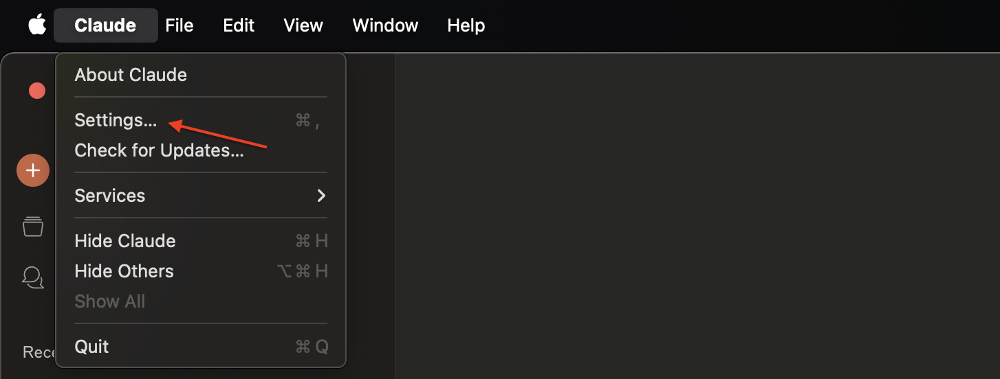

**第 3 步：** 在 `mcpServers` 键下添加你的服务器条目。请务必将 `args` 中的路径替换为 `amazon_scraper_mcp.py` 文件的绝对路径。

```json
{
  "mcpServers": {
    "amazon_product_scraper": {
      "command": "python",  // Or python3 if needed
      "args": ["/full/path/to/your/amazon_scraper_mcp.py"], // <-- IMPORTANT: Use the correct absolute path
    }
  }
}
```

**第 4 步：** 保存 `claude_desktop_config.json` 文件，完全关闭并重新打开 Claude Desktop，使更改生效。

**第 5 步：** 现在，你应该会在 Claude Desktop 的聊天输入区域看到一个小型工具图标（类似锤子 🔨）。


**第 6 步：** 点击该图标后，应会列出你的“亚马逊商品爬虫工具”及其 `fetch_page` 和 `extract_info` 工具。

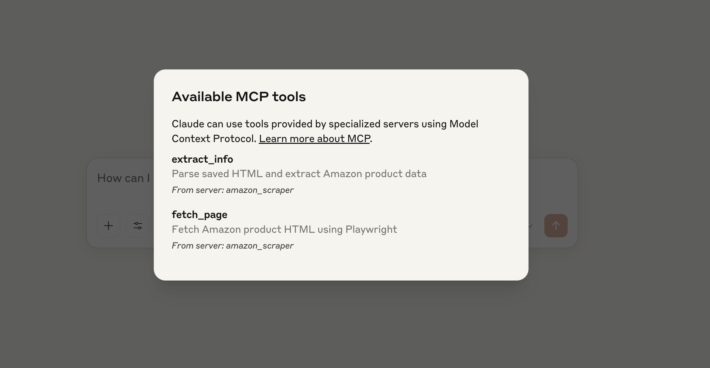

**第 7 步：** 发送提示词，例如：_“获取此亚马逊商品的当前价格、原价和评分：[https://www.amazon.com/dp/B09C13PZX7](https://www.amazon.com/dp/B09C13PZX7)”_。

**第 8 步：** Claude 会检测到该任务需要使用外部工具，并请求你授权先运行 `fetch_page`，然后运行 `extract_info`。为每个工具点击“允许在此聊天中使用”。

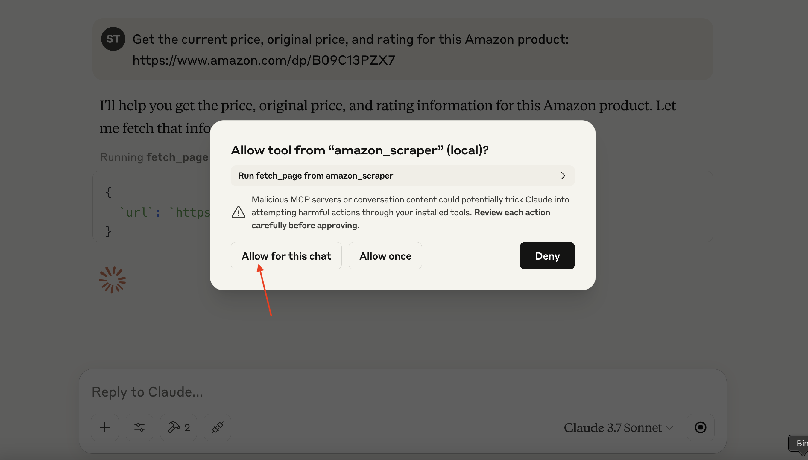

**第 9 步：** 授予权限后，MCP 服务器将执行这些工具。随后，Claude 会接收结构化数据并在聊天中呈现。


### 在 Cursor 中设置

Cursor（一款 AI 优先的 IDE）的设置过程与此类似。

**第 1 步：** 打开 Cursor。

**第 2 步：** 前往 `Settings` ⚙️，然后导航至 `MCP` 部分。

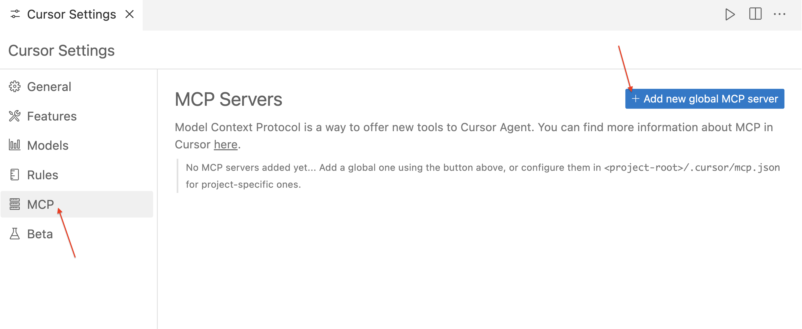

**第 3 步：** 点击“+添加新的全局 MCP 服务器”。这将打开 `mcp.json` 配置文件。为你的服务器添加一个条目，并同样使用脚本的**绝对路径**。

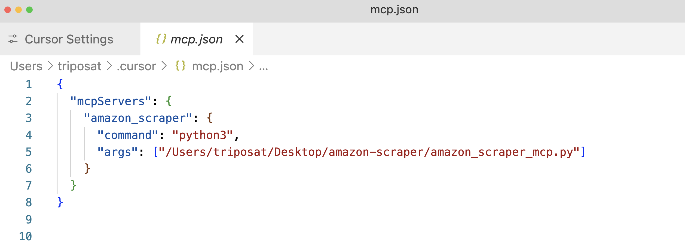

**第 4 步：** 保存 `mcp.json` 文件，你应该会看到列出的“amazon\_product\_scraper”。如果一切正常，旁边会显示一个绿点，表示它正在运行且已连接。

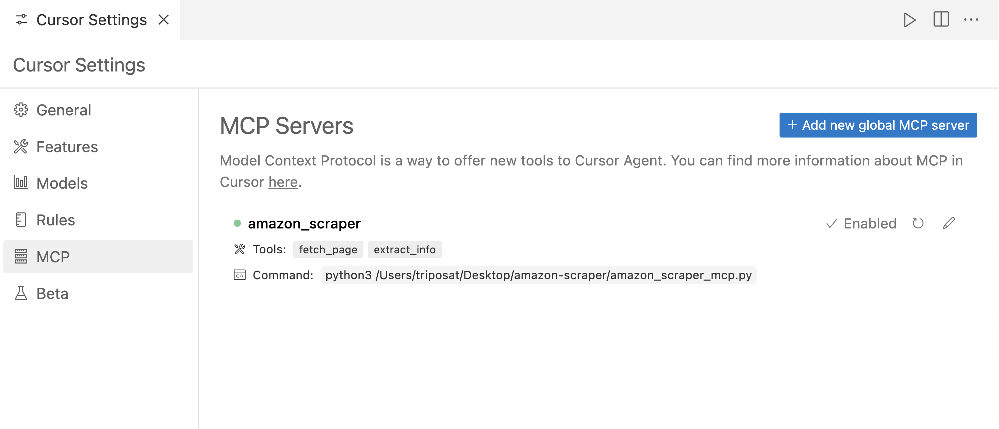

**第 5 步：** 使用 Cursor 的聊天功能（`Cmd+l` 或 `Ctrl+l`）。

**第 6 步：** 发送提示词，例如：“_从此亚马逊 URL 中提取所有可用的商品数据：[https://www.amazon.com/dp/B09C13PZX7](https://www.amazon.com/dp/B09C13PZX7)。将输出格式化为结构化 JSON 对象_。”

**第 7 步：** 与 Claude Desktop 类似，Cursor 会请求运行 `fetch_page` 和 `extract_info` 工具的权限。批准这些请求（“运行工具”）。

**第 8 步：** Cursor 将显示交互流程，包括对 MCP 工具的调用，最后展示 `extract_info` 工具返回的结构化 JSON 数据。

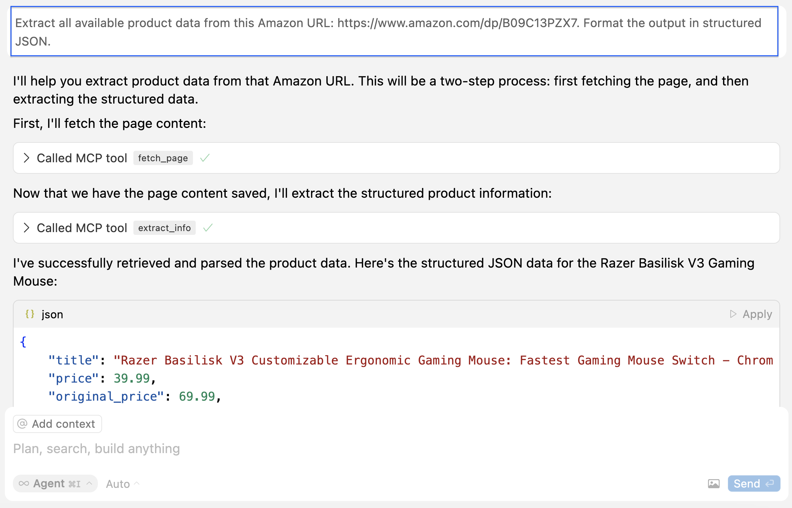 以下是 Cursor 输出的 JSON 示例：

```json
{
  "title": "Razer Basilisk V3 Customizable Ergonomic Gaming Mouse: Fastest Gaming Mouse Switch - Chroma RGB Lighting - 26K DPI Optical Sensor - 11 Programmable Buttons - HyperScroll Tilt Wheel - Classic Black",
  "price": 39.99,
  "original_price": 69.99,
  "discount_percent": 43,
  "rating_stars": 4.6,
  "review_count": 7782,
  "features": [
    "ICONIC ERGONOMIC DESIGN WITH THUMB REST — PC gaming mouse favored by millions worldwide with a form factor that perfectly supports the hand while its buttons are optimally positioned for quick and easy access",
    "11 PROGRAMMABLE BUTTONS — Assign macros and secondary functions across 11 programmable buttons to execute essential actions like push-to-talk, ping, and more",
    "HYPERSCROLL TILT WHEEL — Speed through content with a scroll wheel that free-spins until its stopped or switch to tactile mode for more precision and satisfying feedback that's ideal for cycling through weapons or skills",
    "11 RAZER CHROMA RGB LIGHTING ZONES — Customize each zone from over 16.8 million colors and countless lighting effects, all while it reacts dynamically with over 150 Chroma integrated games",
    "OPTICAL MOUSE SWITCHES GEN 2 — With zero unintended misclicks these switches provide crisp, responsive execution at a blistering 0.2ms actuation speed for up to 70 million clicks",
    "FOCUS+ 26K DPI OPTICAL SENSOR — Best-in-class mouse sensor with intelligent functions flawlessly tracks movement with zero smoothing, allowing for crisp response and pixel-precise accuracy",
    // ... (other features)
  ],
  "availability": "In Stock"
}
```

这体现了 MCP 的灵活性：同一服务器可与不同客户端应用程序无缝协作。

## 使用 Bright Data 的 MCP 进行专业网页数据提取

Bright Data 的企业级[模型上下文协议（MCP）](https://github.com/bright-cn/brightdata-mcp)解决方案消除了自行管理 MCP 服务器的复杂性，例如代理管理、[反机器人拦截绕过](https://www.bright.cn/blog/web-data/anti-scraping-techniques)和扩展难题，并可与 [AI 智能体](https://www.bright.cn/ai/web-access)及 LLM 无缝集成。

连接 Bright Data 的 MCP 后，你可以立即访问公开网络数据，包括 SERP 结果和难以访问的网站，并针对 AI 工作流进行了优化。

MCP 通过[网络解锁器](https://www.bright.cn/products/web-unlocker)、[搜索引擎 API](https://www.bright.cn/products/serp-api)、[网页爬虫工具 API](https://www.bright.cn/products/web-scraper)和[抓取浏览器](https://www.bright.cn/products/scraping-browser)等工具，构建强大的网页提取框架，提供：

- **[AI 就绪数据](https://www.bright.cn/ai)：** 内容已预先结构化，无需预处理。
- **可扩展性和可靠性：** 支持大规模数据处理且不会减速。
- **绕过封锁和验证码：** 高级反机器人能力。
- **全球 IP 覆盖：** 通过 [Bright Data 代理](https://www.bright.cn/proxy-types)访问 195 个国家/地区。
- **无缝集成：** 可快速与任何 MCP 客户端完成设置。

### Bright Data MCP 的前提条件

开始集成 Bright Data MCP 前，请确认你具备以下条件：

1. **Bright Data 账户：** 在 [brightdata.com](https://www.bright.cn/) 注册。首次使用的用户可获得免费测试额度。
2. **API 令牌：** 从 Bright Data 账户设置（[用户设置页面](https://www.bright.cn/cp/setting/users)）中获取并妥善保管 API 令牌。
3. **网络解锁器区域：** 在 Bright Data 控制面板中[创建一个网络解锁器代理](https://docs.brightdata.com/scraping-automation/web-unlocker/quickstart)区域。选择一个容易记住的标识符，例如 `mcp_unlocker`（如有需要，之后可通过环境变量修改）。
4. **（可选）抓取浏览器区域：** 如果需要高级浏览器自动化功能（例如复杂的 JavaScript 交互或截图），请[创建一个抓取浏览器区域](https://docs.brightdata.com/scraping-automation/scraping-browser/quickstart)。记录为此区域提供的身份验证信息（用户名和密码），这些信息位于 **概览**选项卡中，通常采用 `brd-customer-ACCOUNT_ID-zone-ZONE_NAME:PASSWORD` 格式。

### 快速入门：为 Claude Desktop 配置 Bright Data MCP

**第 1 步：** Bright Data MCP 服务器通常使用 Node.js 自带的 `npx` 运行。如果尚未安装 Node.js，请从[官方网站](https://nodejs.org/en/download)安装。

**第 2 步：** 打开 Claude Desktop -> `Settings` -> `Developer` -> `Edit Config`（`claude_desktop_config.json`）。

**第 3 步：** 在 `mcpServers` 下插入 Bright Data 服务器配置。将占位符替换为你的实际凭据。

```json
{
  "mcpServers": {
    "Bright Data": { // Choose a name for the server
      "command": "npx",
      "args": ["@brightdata/mcp"],
      "env": {
        "API_TOKEN": "YOUR_BRIGHTDATA_API_TOKEN", // Paste your API token here
        "WEB_UNLOCKER_ZONE": "mcp_unlocker",     // Your Web Unlocker zone name
        // Optional: Add if using Scraping Browser tools
        "BROWSER_AUTH": "brd-customer-ACCOUNTID-zone-YOURZONE:PASSWORD"
      }
    }
  }
}
```

**第 4 步：** 保存配置文件并重启 Claude Desktop。

**第 5 步：** 将鼠标悬停在 Claude Desktop 的锤子图标（🔨）上。此时你应该会看到多个可用的 MCP 工具。


下面尝试从 Zillow 提取数据，该网站以可能限制爬虫工具而闻名。向 Claude 输入提示词：“_从此 Zillow URL 中提取关键房产数据并以 JSON 格式返回：[https://www.zillow.com/apartments/arverne-ny/the-tides-at-arverne-by-the-sea/ChWHPZ/](https://www.zillow.com/apartments/arverne-ny/the-tides-at-arverne-by-the-sea/ChWHPZ/)_”

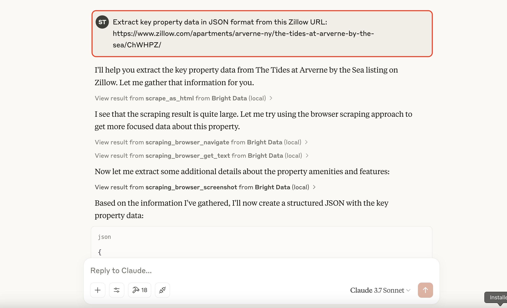

允许 Claude 使用所需的 Bright Data MCP 工具。Bright Data 的 MCP 服务器将处理底层复杂流程（动态代理，以及必要时通过抓取浏览器进行 JavaScript 渲染）。

Bright Data 的服务器会执行提取并提供结构化数据，再由 Claude 进行展示。

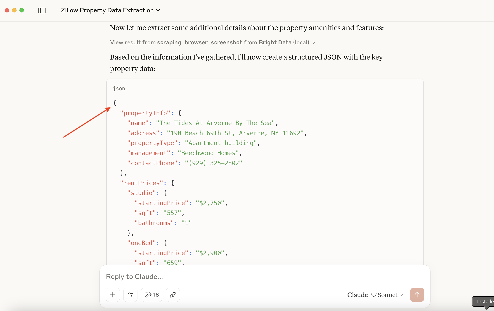

以下是可能的输出示例：

```json
{
  "propertyInfo": {
    "name": "The Tides At Arverne By The Sea",
    "address": "190 Beach 69th St, Arverne, NY 11692",
    "propertyType": "Apartment building",
    // ... more info
  },
  "rentPrices": {
    "studio": { "startingPrice": "$2,750", /* ... */ },
    "oneBed": { "startingPrice": "$2,900", /* ... */ },
    "twoBed": { "startingPrice": "$3,350", /* ... */ }
  },
  // ... amenities, policies, etc.
}
```

**另一个示例：Hacker News 标题**

再来看一个更简单的查询：“_向我提供 Hacker News 最新 5 篇新闻文章的标题_”。

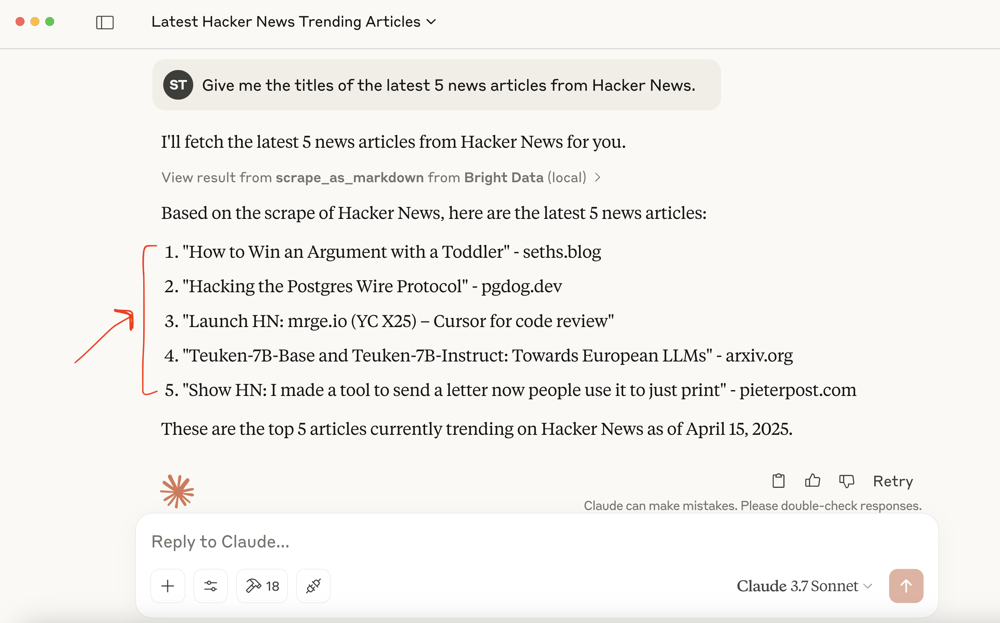

这展示了 Bright Data 的 MCP 服务器如何简化访问动态或受到严密保护的网络内容，让你可以直接在 AI 工作流中使用这些数据。

## 延伸阅读

以下是我们之前发布的 AI 和大语言模型（LLM）指南精选，可帮助你深入了解相关知识：

- [查找 LLM 训练数据的主要来源](https://www.bright.cn/blog/web-data/llm-training-data)
- [使用 LLaMA 3 进行网页爬虫：将任何网站转换为结构化 JSON](https://www.bright.cn/blog/web-data/web-scraping-with-llama-3)
- [使用 LangChain 和 Bright Data 进行网页爬虫](https://www.bright.cn/blog/ai/web-scraping-with-langchain-and-bright-data)
- [如何使用 SERP 数据和 GPT-4o 创建 RAG 聊天机器人](https://www.bright.cn/blog/web-data/build-a-rag-chatbot)

## 总结

Anthropic 的模型上下文协议从根本上改变了 AI 系统与外部世界交互的方式。你可以为特定任务构建自定义 MCP 服务器。Bright Data 的 MCP 集成在此基础上进一步增强功能，提供企业级网页爬虫能力，能够绕过反机器人保护并提供 [AI 就绪的结构化数据](https://www.bright.cn/ai)。

立即注册并免费试用 [AI 解决方案](https://www.bright.cn/ai)！
